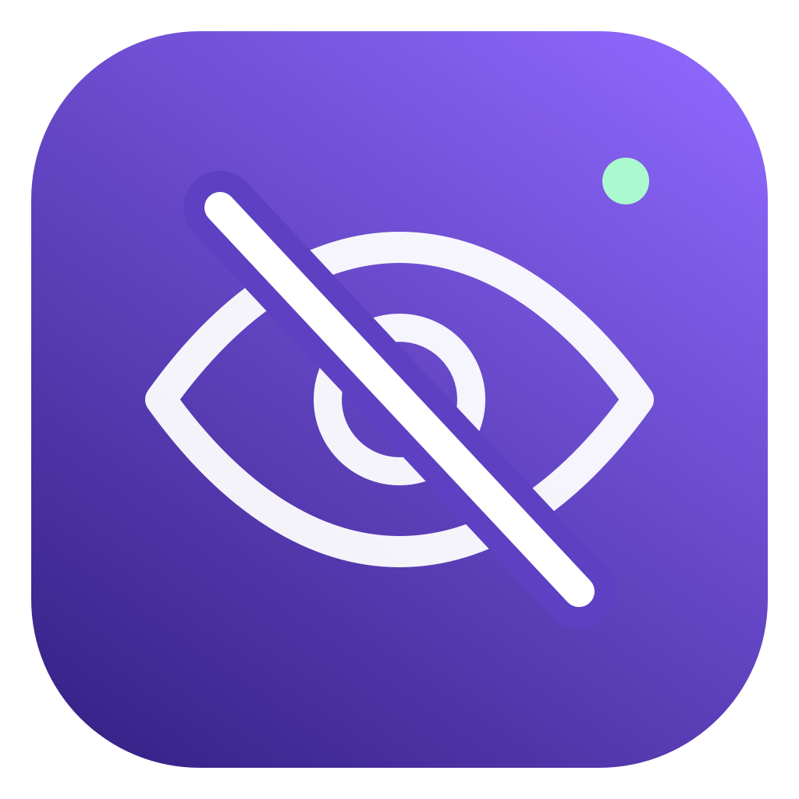

# NotLooking · 没在看



**Look away. Your screen gets the hint.**

A native macOS menu bar app that reads AirPods head motion, blurs your screen when you turn away, and clears it when you look back. Based on [HeadOrbit](https://github.com/Cogria-AI/HeadOrbit).

[中文](README.md) · [Download](https://github.com/tuotuogao/NotLooking/releases)

## Changes in this fork

- Guided first use: Motion & Fitness permission, headphone connection, three-second forward calibration, and a real turn-and-return test. A disconnection cannot pass the test.
- A visible eye icon with a short menu bar label. Reopen the app from Applications to show its settings window, even when the menu item is hidden. Closing settings keeps the app running.
- Login-at-startup control, including a link for system approval when needed.
- Independent 0–100% blur strength for each direction, separate from dimming, with a two-second preview and automatic saving. Default: 50%; 0% applies dimming only.
- Independent bundle ID `io.github.tuotuogao.NotLooking` and update checks against this repository.
- Original scenes, posture reminders, head-controlled key actions, neck exercises, and English/Chinese/Japanese remain available.

## Quick start

Requires macOS 14+ and compatible head-tracking AirPods / Beats connected to this Mac. Release packages are universal (Apple Silicon and Intel). Download the DMG from Releases, move NotLooking into Applications, then follow the four-step guide.

Defaults: turn left or right past **35° for 0.6 seconds** to blur; look back to clear. Tune each direction in Privacy blur. Headphone data stays local. Only Motion & Fitness is needed for blur; Accessibility is optional for simulated key actions. No camera, microphone, or screen recording permission is required.

Builds are ad-hoc signed and are not Apple-notarized. macOS may require Open Anyway under Privacy & Security after you verify the source. Screen blur supplements privacy rather than replacing screen locking; if the private blur API is unavailable, it falls back to dimming.

## Development

Install Xcode 15+ and [XcodeGen](https://github.com/yonaskolb/XcodeGen), then:

```sh
./build.sh
bash Tests/run-motion.sh
./package.sh
```

Build: `build/Build/Products/Debug/NotLooking.app`. Package: `dist/NotLooking-v1.0.0.dmg`. Enable Actions on the fork before pushing a `v*` tag to use the release workflow. Rebuild the native vector icon with `bash scripts/make-icon.sh`.

NotLooking has its own preferences and permissions; HeadOrbit settings are not automatically imported.

After restarting, look at the screen and calibrate again before protection starts. A manual launch opens Calibration; a login launch stays in the menu bar with a calibration prompt.

## Credits

Derived from Cogria-AI/HeadOrbit v2.1.0. Original copyright, MIT license, and commit history are preserved. NotLooking additions are maintained by tuotuogao. Original documentation is archived in [docs/upstream](docs/upstream/README.md). See [LICENSE](LICENSE).
